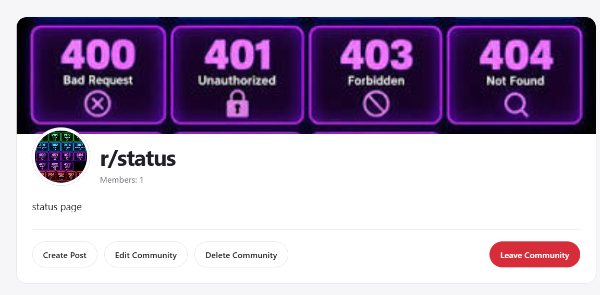
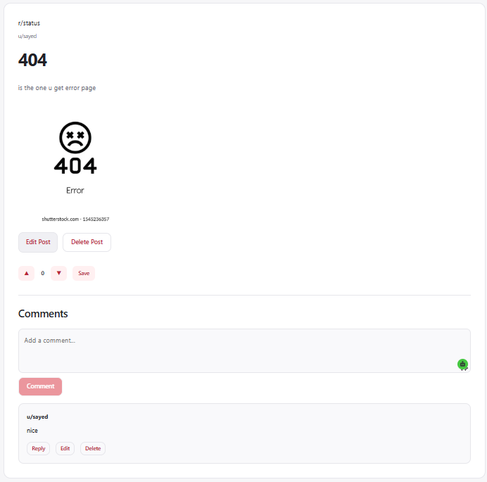
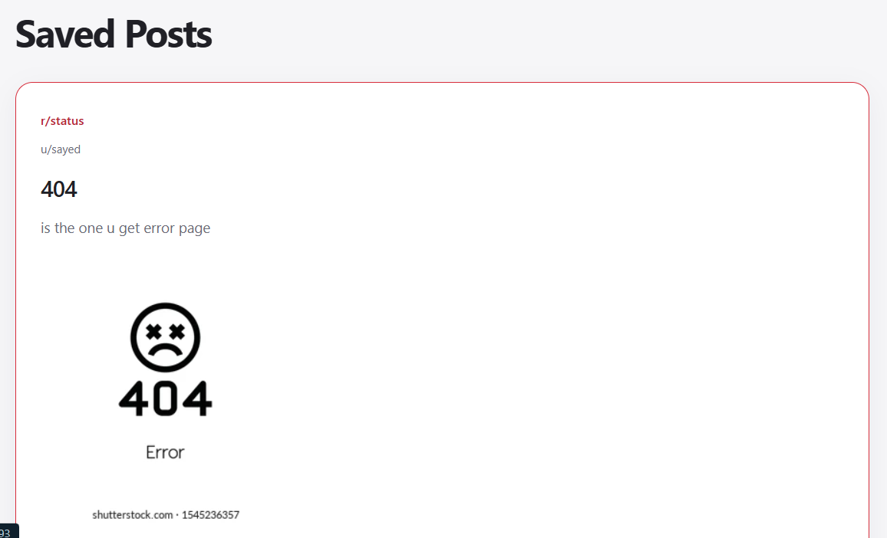

# Threadly Frontend

## Overview

Threadly is a community discussion app where users discover shared interests, join communities, and take part in conversations. The React frontend connects to a separate backend API.

Browse communities and posts without an account. Sign up and sign in to create or join a community, publish posts, comment and reply, vote, and save posts to your bookmarks. Join a community before creating posts or participating in its comments.

## Live Application

- **Frontend:** 
- **Backend API:** For local development, use `http://localhost:3000`.
- **Backend Repository:** [Threadly Backend](https://github.com/Sayed-2003/threadly-backend)

## Screenshots

### Home Page


### Feature Page



### Other pages





## Technologies Used

- React
- Vite
- React Router
- Axios
- React Hot Toast
- CSS
- ESLint

## Features

- User registration, login, and logout with JWT authentication.
- Protected routes for the dashboard, bookmarks, and creation and editing pages.
- Browse, create, join, and leave communities.
- Edit and delete communities you own.
- Create posts with images, and edit or delete your own posts.
- Add comments and nested replies, and edit or delete your own comments.
- Upvote and downvote posts.
- Bookmark posts and view saved posts.
- Personal dashboard.
- Light and dark themes with a locally saved preference.

## Project Structure

```text
src/
├── assets/
├── components/
├── design/
├── pages/
│   ├── bookmarks/
│   ├── communities/
│   └── posts/
├── services/
├── App.jsx
├── index.css
└── main.jsx
```

## Getting Started

### Prerequisites

Install the following before running the project:

- Node.js compatible with Vite 8.
- npm.

The [Threadly backend API](https://github.com/Sayed-2003/threadly-backend) must be running with its database configured. The local API URL is `http://localhost:3000`.

## Installation

### 1. Clone the repository

```bash
git clone https://github.com/Sayed-2003/threadly-frontend.git
cd threadly-frontend
```

### 2. Install dependencies

```bash
npm install
```

### 3. Create the environment file

Create a `.env` file in the frontend root directory:

```env
VITE_BACK_END_SERVER_URL=http://localhost:3000
```

Replace this value with your deployed backend URL when needed. Restart the development server after changing it. Configure the backend's `CLIENT_URL` to allow the frontend origin.

### 4. Start the development server

```bash
npm run dev
```

Go to:

```text
http://localhost:5173
```

If that port is unavailable, use the URL printed in the terminal.

## Application Routes

| Route | Page | Access |
| --- | --- | --- |
| `/` | Home page | Public |
| `/sign-up` | Registration page | Public |
| `/sign-in` | Login page | Public |
| `/dashboard` | Personal dashboard | Authenticated |
| `/communities` | Community list | Public |
| `/communities/:communityId` | Community details and posts | Public |
| `/communities/:communityId/edit` | Edit community | Community owner |
| `/communities/:communityId/posts/create` | Create post | Authenticated community member |
| `/posts` | Post feed | Public |
| `/posts/:postId` | Post details and comments | Public |
| `/posts/:postId/edit` | Edit post | Post author |
| `/bookmarks` | Saved posts | Authenticated |

Community creation opens in a modal for signed-in users.

## User Stories

- As a visitor, I want to browse communities and posts so I can discover topics that interest me.
- As a user, I want to register and sign in so I can participate in discussions.
- As a user, I want to create and join communities so I can connect with people who share my interests.
- As a community member, I want to publish posts, comment, and reply so I can contribute to conversations.
- As a content author, I want to edit or delete my posts and comments so I can manage my contributions.
- As a community owner, I want to edit or delete my community so I can manage it.
- As a user, I want to vote on and bookmark posts so I can highlight useful discussions and revisit them.
- As a user, I want to switch themes so I can choose a comfortable appearance.

## Future Enhancements

- Search and filtering for communities and posts.
- User profiles with activity history.
- Notifications for replies and community activity.
- Community moderation tools.

## Team Members

| Name | GitHub |
| --- | --- |
| Sayed Baqer | Comments and upload plus search bar |
| Ali Kamel | vote and bookmark |
| Ammar Mohammed | Community and posts and upload |

## Credits

- [React](https://react.dev/), [Vite](https://vite.dev/), and [React Router](https://reactrouter.com/) for the frontend foundation.
- [Axios](https://axios-http.com/) for API requests.
- [React Hot Toast](https://react-hot-toast.com/) for notifications.
